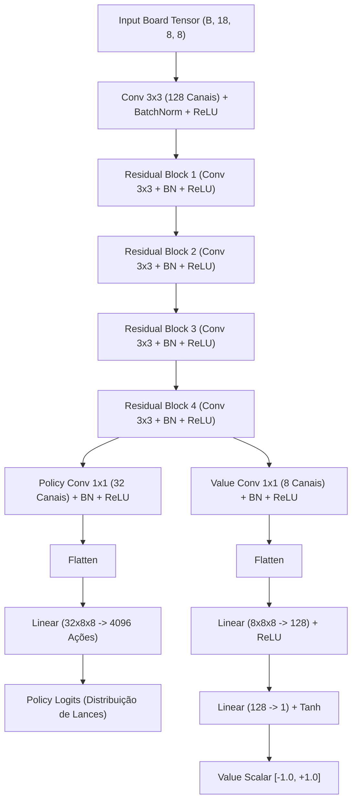

# Chess Neural Bot - Destilação de Aberturas Polyglot (Policy-Value ResNet)

Módulo neural de xadrez em `s_Neura_Gym/chess_bot/Neural_Bot`.

Este subsistema transforma as **80.601 posições de abertura** do livro oficial de Grandes Mestres (`balanced.bin` do bot de 3200 Elo) em **pesos sinápticos de uma Rede Neural Residual (ResNet Policy-Value)**.

---

## 1. Visão Geral e Conceito (*Policy Distillation*)

Em abordagens tradicionais de aprendizado por reforço (RL), agentes neurais iniciam com pesos aleatórios (*cold start*), demorando milhares de partidas para aprender princípios elementares de abertura.

A técnica de **Destilação de Política (*Behavioral Cloning / Policy Distillation*)**:
1. Extrai a árvore completa de aberturas de Grandes Mestres do `balanced.bin` (65.451 estados canônicos únicos).
2. Converte as posições em tensores $18 \times 8 \times 8$ (perspectiva canônica para ambos os lados).
3. Converte os pesos Polyglot dos lances em uma distribuição de probabilidade alvo $\pi(a|s)$.
4. Treina a rede neural com aceleração por GPU (CUDA / RTX 3060) usando perda de Entropia Cruzada (*Cross-Entropy Loss*) e regularização AdamW.
5. Salva os pesos resultantes em `checkpoints/chess_policy_weights.pt` e exporta para formato universal `checkpoints/chess_policy_weights.onnx`.

---

## 2. Arquitetura da Rede (`ChessPolicyValueNet`)



### Características Técnicas:
- **Espaço de Estados:** $18 \times 8 \times 8$ (12 planos de peças + 1 en passant + 4 direitos de roque + 1 vez de jogar).
- **Simetria Canônica:** Se for o turno das pretas, o tabuleiro é automaticamente invertido verticalmente e as cores são invertidas. O modelo sempre aprende "do ponto de vista de quem joga".
- **Espaço de Ações:** $4.096$ ações ($64 \times 64$ casas de origem e destino).
- **Parâmetros:** ~2.5 milhões de parâmetros, permitindo inferência ultra-rápida (< 3 ms por lance na GPU).

---

## 3. Estrutura de Diretórios
 
```
Neural_Bot/
├── chess_ai/
│   ├── __init__.py
│   ├── agent.py              # Agente de inferência neural (NeuralChessBot)
│   ├── batched_env.py        # Ambiente vetorizado de xadrez na GPU
│   ├── batched_rl_trainer.py # Treinador massivo paralelo (64 workers + AMP)
│   ├── dataset.py            # Extrator Polyglot e DataLoader PyTorch
│   ├── encoder.py            # Codificador de tabuleiro e lances canônicos
│   ├── mcts.py               # Busca em Árvore Monte Carlo com Anti-Blunder
│   ├── model.py              # Arquitetura ResNet com dupla cabeça
│   ├── online_learning.py    # Aprendizado online imediato após cada jogo
│   └── trainer.py            # Pipeline de destilação supervisionada
├── checkpoints/              # Pesos treinados (.pt, .onnx) e histórico de treino
│   ├── chess_policy_weights.pt
│   ├── chess_policy_weights.onnx
│   └── torneio_1000_history.json
├── tests/                    # Testes automatizados (pytest)
└── README.md                 # Esta documentação
```

---

## 4. Como Treinar a Rede (Converter o `.bin` em Pesos)

### Opção 1: Pela Central Unificada (Recomendado)
Execute `arena.bat` ou pelo terminal:
```bash
python arena_cli.py --mode destilar --epochs 8
```

### Opção 2: Pelo Menu Interativo
Execute `arena.bat`, selecione a **Opção [7] (Retreinar / Destilar Livro de Aberturas)**.

---

## 5. Como Jogar Contra a Rede Treinada

### Opção 1: Interface Gráfica Web (Web Arena)
```bash
python arena_cli.py --mode web
```
Acesse `http://localhost:8000` para jogar com tabuleiro arrastável e barra de avaliação em tempo real.

### Opção 2: Pelo Terminal Interativo
```bash
python arena_cli.py --mode neural --color white --mcts 200
```
Cada partida jogada treina e aperfeiçoa a rede automaticamente ao final.

---

## 6. Utilização em Código Python

```python
import chess
from chess_ai.agent import NeuralChessBot

# Carrega os pesos da rede
agent = NeuralChessBot(weights_path="checkpoints/chess_policy_weights.pt")

board = chess.Board()

# Predição neural
move, info = agent.get_best_move(board)

print(f"Lance escolhido pela rede: {board.san(move)}")
print(f"Confiança: {info['probability']*100:.1f}%")
print(f"Avaliação posicional: {info['value']:+.2f}")
print("Top 3 lances considerados:", info.get("top_candidates"))
```

---

## 7. Execução dos Testes

```bash
python -m pytest tests/ -v
```
Todos os 7 testes validam codificação, simetria canônica, saída da rede, extração de dados e inferência do agente.
