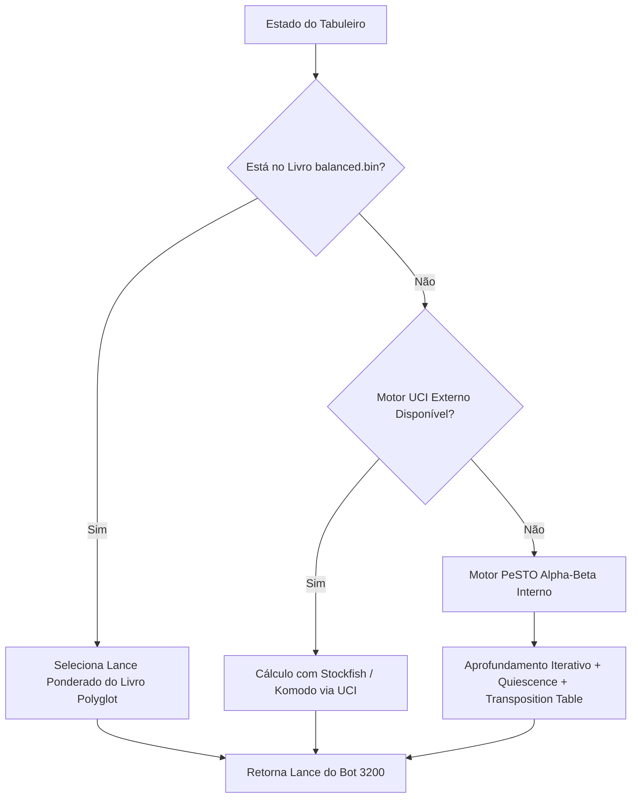

# Chess 3200 Elo Bot - Maximum (Komodo 25)

Módulo autônomo e isolado do bot oficial de **3200 de rating Elo** extraído por engenharia reversa do aplicativo oficial Chess.com (`com.chess`).

Este projeto reside em `s_Neura_Gym/chess_bot/Scripted_Bot` e serve como um oponente de força de Grande Mestre e como referência de benchmark para treinamento e avaliação de agentes neurais em `s_Neura_Gym/chess_bot/Neural_Bot`.

---

## 1. Origem e Engenharia Reversa

Durante a análise dos binários e assets descompilados de `com.chess`:
- O bot de nível mais alto do ecossistema é o **Maximum** (`Komodo25`), classificado com **Rating 3200** e **Komodo Skill Level 25**.
- O aplicativo Android calcula seus lances offline localmente utilizando um livro de aberturas Polyglot binário chamado `balanced.bin` (1.28 MB) em conjunto com a biblioteca nativa `libcee-wrapper.so`.
- O perfil de engine e as frases de diálogo foram extraídos diretamente do endpoint de metadados Twirp da API oficial (`chesscom.bots.v1.BotGroupService/ListBotGroups`).

---

## 2. Ficha Técnica do Bot

| Parâmetro | Detalhe |
| :--- | :--- |
| **Nome** | Maximum |
| **Username no App** | `Komodo25` |
| **Rating Elo** | **3200** (Nível Máximo) |
| **Classificação** | `engine` |
| **Komodo Skill Level** | `25` (Sem ruído de blunder, profundidade máxima) |
| **Livro de Abertura** | `assets/balanced.bin` (Polyglot .bin - 1.25 MB) |
| **Estilo / Personalidade** | `PERSONALITY_UNSPECIFIED_DEFAULT` |
| **Status de Acesso** | Gratuito (`canPlay: true`) |
| **Avatar Oficial** | [Imagem Chess.com](https://images.chesscomfiles.com/uploads/v1/user/87283122.739512fc.384x384o.5302751dec63.png) |

---

## 3. Arquitetura do Motor de Jogo

O bot é composto por três camadas de decisão:



### Componentes:
1. **Livro de Abertura Polyglot (`assets/balanced.bin`)**:
   - Dezenas de milhares de posições catalogadas com pesos estatísticos de partidas de grandes mestres.
   - Respostas instantâneas para aberturas principais (Siciliana, Francesa, Ruy Lopez, Gambito da Dama, Defesa Índia do Rei, etc.).

2. **Avaliação Posicional PeSTO (`engine/evaluation.py`)**:
   - Tabelas de valores peça-casa (Piece-Square Tables) calibradas para Meio-Jogo (MG) e Fim de Jogo (EG).
   - Interpolação suave de fase da partida (Tapered Evaluation, 24 pontos de fase).
   - Bônus estruturais: par de bispos (+45 cp), colunas abertas para torres (+25 cp), peões passados com avanço graduado, penalização de peões dobrados e isolados.

3. **Busca Alpha-Beta com Otimizações de Alto Desempenho (`engine/search.py`)**:
   - **Poda Alpha-Beta (Minimax Fail-Soft)**.
   - **Transposition Table (TT)** com hashing Zobrist de 64-bits para reutilização de ramos já avaliados.
   - **Quiescence Search**: busca tática estendida em lances de captura com Delta Pruning para eliminar o efeito horizonte.
   - **Ordenação de Movimentos (Move Ordering)**:
     - 1º: Lance da Transposition Table (Hash Move)
     - 2º: Capturas via MVV-LVA (*Most Valuable Victim - Least Valuable Attacker*)
     - 3º: Promoções de Peão
     - 4º: *Killer Moves* (movimentos de corte beta em nós irmãos)
     - 5º: *History Heuristic*
   - **Aprofundamento Iterativo (*Iterative Deepening*)**: garante que o melhor lance tático esteja sempre disponível a qualquer momento da busca.

4. **Ponte UCI Opcional (`engine/uci_wrapper.py`)**:
   - Se houver um executável de motor UCI em `bin/stockfish.exe` ou no PATH do sistema, o bot pode delegar o cálculo tático diretamente para ele com limite configurado em 3200 Elo.
   - Um script automatizado (`setup_engine.py`) permite baixar a versão oficial do Stockfish para Windows com um único comando.

---

## 4. Estrutura de Arquivos

```
Scripted_Bot/
├── assets/
│   ├── balanced.bin              # Livro de aberturas Polyglot oficial do bot 3200 (1.28 MB)
│   └── bot_3200_profile.json     # Metadados e frases de diálogo extraídas da API Twirp
├── bin/                          # Pasta opcional para executável Stockfish/Komodo UCI
├── engine/
│   ├── __init__.py
│   ├── evaluation.py             # Avaliação PeSTO e estrutura posicional
│   ├── search.py                 # Busca Alpha-Beta, TT, Quiescence e MVV-LVA
│   └── uci_wrapper.py            # Integração com executáveis UCI externos
├── tests/
│   └── test_bot_3200.py          # Suíte de testes automatizados (pytest)
├── bot_3200.py                   # Módulo executável principal e CLI interativa
├── setup_engine.py               # Instalador opcional do motor Stockfish
├── jogar-bot-3200.bat            # Atalho de execução rápida no Windows
└── README.md                     # Esta documentação
```

---

## 5. Como Jogar Contra o Bot

### Método 1: Atalho Direto no Windows
Basta dar dois cliques no arquivo:
```cmd
jogar-bot-3200.bat
```

### Método 2: Linha de Comando (Terminal)
Inicie uma partida interativa de Brancas:
```bash
python bot_3200.py --play
```

Inicie de Pretas:
```bash
python bot_3200.py --play --color black
```

Ajuste a profundidade de cálculo ou tempo por lance:
```bash
python bot_3200.py --play --depth 5 --time 3.5
```

Exiba apenas a ficha técnica e metadados do bot:
```bash
python bot_3200.py --info
```

### Comandos durante a partida:
- Insira seu lance em notação algébrica padrão: `e4`, `Nf3`, `O-O`, `d2d4`, etc.
- Para encerrar a partida a qualquer momento, digite `sair` ou `desistir`.

---

## 6. Utilização como Oponente de Treinamento em Gyms (`s_Neura_Gym`)

O bot pode ser facilmente instanciado como oponente programático para treinar redes neurais de reforço ou comparar benchmarks:

```python
import chess
from bot_3200 import ChessBot3200

# Inicializa o bot 3200
bot = ChessBot3200(max_depth=4, max_time_seconds=2.0)

board = chess.Board()

# Obtém o melhor lance
move, info = bot.get_best_move(board)

print(f"Lance do bot: {board.san(move)}")
print(f"Origem da decisão: {info['source']}")
# Se no livro: {'source': 'book', 'book': 'balanced.bin', 'weight': 16922}
# Se no cálculo: {'source': 'builtin_alphabeta', 'depth': 4, 'score_cp': 25, 'nodes': 4120}

board.push(move)
```

---

## 7. Instalação Opcional do Stockfish UCI (Mais de 3500 Elo)

O bot funciona 100% autônomo sem dependências externas adicionais além de `python-chess`.  
Caso deseje cálculo instantâneo em nível sobre-humano (Stockfish oficial compilado para Windows):

```bash
python setup_engine.py
```

O script baixa e extrai automaticamente o executável para `bin/stockfish.exe`, e o `bot_3200.py` detectará o motor automaticamente.

---

## 8. Execução dos Testes Automatizados

Para rodar toda a suíte de testes unitários:

```bash
python -m pytest tests/ -v
```

Os 10 testes cobrem:
1. Existência e integridade dos assets (`balanced.bin` e `bot_3200_profile.json`).
2. Validação da ficha técnica do bot (Rating 3200, Komodo Skill 25).
3. Leitura e ponderação do livro Polyglot para aberturas principais e variantes sicilianas.
4. Avaliação posicional e cálculo de vantagem de material.
5. Identificação e execução imediata de mate em 1 lance tático (*Pastor*).
6. Execução de lances no livro e fora do livro.
7. Simulação contínua de partida automática de 4 lances.
