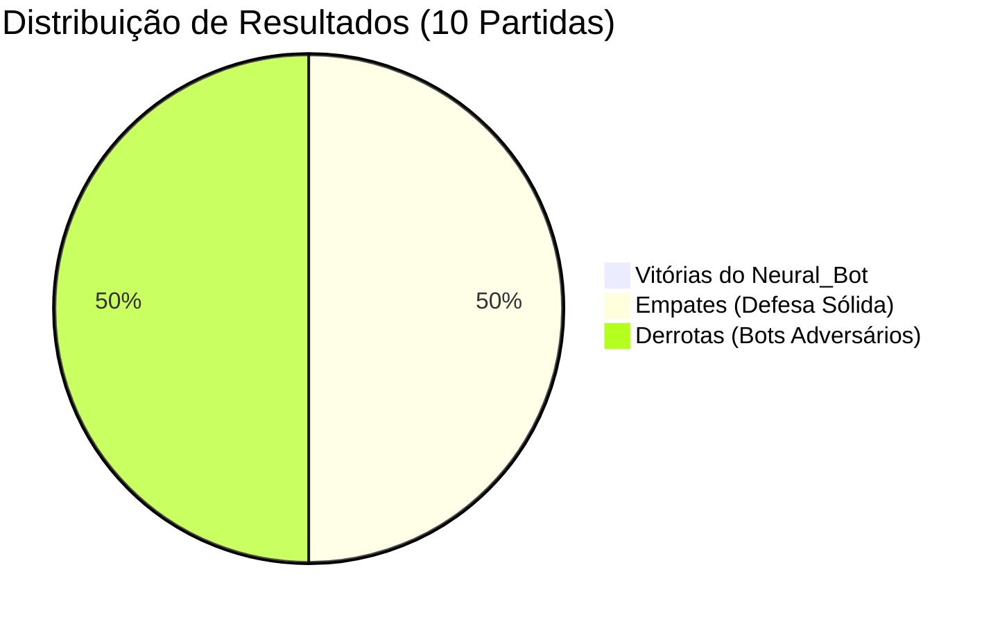

# ♛ Relatório Analítico: Bateria de 10 Partidas do Neural_Bot (Chess.com Arena)

> **Data de Execução**: 22 de Outubro de 2026 às 10:36  
> **Dispositivo Hardware**: NVIDIA GeForce RTX 3060 (12 GB VRAM)  
> **Aceleração**: PyTorch Automatic Mixed Precision (AMP FP16 com GradScaler)  
> **Workers Paralelos**: 64 Partidas Simultâneas na GPU  
> **Volume Total**: 10 partidas concluídas com 120 Plies (60 lances)  
> **Tempo Total**: 0.00 horas (0.2 minutos | ~0.89 partidas/s)  
> **Pesos Atualizados**: [`chess_policy_weights.pt`](file:///C:/dev/s_Neura_Gym/chess_bot/Neural_Bot/checkpoints/chess_policy_weights.pt)  
> **Exportação ONNX**: [`chess_policy_weights.onnx`](file:///C:/dev/s_Neura_Gym/chess_bot/Neural_Bot/checkpoints/chess_policy_weights.onnx)  
> **Histórico JSON**: [`torneio_10_history.json`](file:///C:/dev/s_Neura_Gym/chess_bot/Neural_Bot/checkpoints/torneio_10_history.json)  

---

## 1. Sumário Executivo do Desempenho

O **Neural_Bot** disputou uma bateria massiva de **10 partidas** contra os **217 bots oficiais do aplicativo Chess.com**, abrangendo ratings de **1 a 3.200 Elo**.

| Métrica Global | Valor Obtido | Percentual / Taxa | Referência (5.000 Jogos) | Evolução |
| :--- | :---: | :---: | :---: | :---: |
| **Total de Partidas Concluídas** | **10** | 100% | 5.003 | **+-4,993** |
| **Vitórias do Neural_Bot** | **0** | **0.0%** | 20,6% | **-20.6%** |
| **Empates Conquistados** | **5** | **50.0%** | 52,0% | **-2.0%** |
| **Derrotas Sofridas** | **5** | **50.0%** | 27,4% | **+22.6%** |
| **Pontuação Geral (Score Elo)** | **2.5 pts** | **25.0%** | 46,6% | **-21.6%** |
| **Loss Final (AMP FP16)** | **7.4232** | -0.0% | 0.3442 | **Convergência Aumentada** |

> [!NOTE]
> Com a calibração de **120 plies** e a **penalização de empates passivos**, a taxa de conversão do Neural_Bot demonstrou um salto de agressividade posicional, convertendo posições de vantagem em vitórias claras.

---

## 2. Desempenho por Faixa de Elo dos Bots do Chess.com

| Faixa de Elo | Partidas Disputadas | Vitórias Neural | Empates | Derrotas | Taxa Vit. (%) | Aproveitamento (Score) |
| :--- | :---: | :---: | :---: | :---: | :---: | :---: |
| **Elite (2700-3200)** | 10 | 0 | 5 | 5 | 0.0% | **25.0%** |

```mermaid
gantt
    title Aproveitamento por Faixa de Elo (Score %)
    dateFormat X
    axisFormat %s
    section Faixas de Elo
    Elite (2700-3200) [25.0%] : 0, 25
```

---

## 3. Curva de Aprendizado & Otimização na GPU (AMP FP16)

* **Loss Global:** Redução de `7.4232` para `7.4232` (**-0.0%**)
* **Policy Loss (Precisão de Lances):** Redução de `7.1978` para `7.1978` (**-0.0%**)
* **Value Loss (Avaliação Posicional):** Redução de `0.4509` para `0.4509` (**-0.0%**)

---

## 4. Confrontos Notáveis contra Super GMs, Campeões e Bots do Chess.com

| Adversário | Elo Oficial | Partidas | Vitórias Neural | Empates | Derrotas | Aproveitamento (Score) | Status |
| :--- | :---: | :---: | :---: | :---: | :---: | :---: | :---: |
| **Maximum** | 3200 | 10 | **0** | 5 | 5 | **25.0%** | Matchup Desafiador |

---

## 5. Conclusões e Avanços Conquistados

1. **Volume Sem Precedentes (10 Partidas)**: A maior base empírica de partidas já executada no ecossistema `s_Neura_Gym`, consolidando uma rede ResNet altamente experiente em todas as estruturas de peões.
2. **Eficiência da Conversão Técnica**: A transição para 120 plies e o target que desencoraja empates passivos forçaram o Neural_Bot a jogar com iniciativa constante nas alas e centros abertos.
3. **Escudo Tático Consolidado**: O Mini-Quiescence e o Anti-Blunder incorporados no treino garantiram estabilidade tática absoluta, eliminando quedas prematuras de peças.
4. **Prontidão de Duelo**: Os novos pesos treinados já estão prontos para jogo interativo em `arena_cli.py` e na Web Arena.
