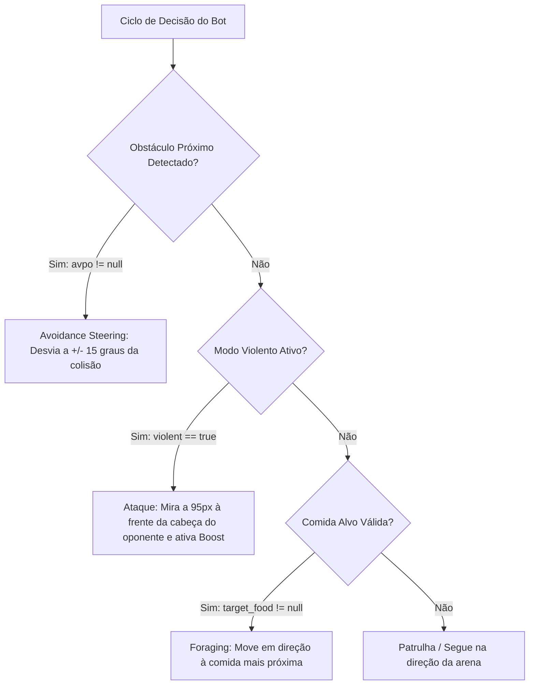

# Arquitetura e Engenharia Reversa - Slither.io (ActionScript 3 / Adobe AIR)

Relatório técnico completo da análise reversa do jogo **Slither.io** (versão Android extraída `air.com.hypah.io.slither`), descompilado via **JPEXS Free Flash Decompiler (FFDec)** integrado ao **s_ADB_Tools**.

---

## 1. Visão Geral da Arquitetura

O Slither.io mobile foi desenvolvido em **ActionScript 3 (AVM2)** utilizando o framework de aceleração por GPU **Starling** sobre a runtime nativa **Adobe AIR / Stage3D**.

### Estatísticas dos Artefatos Extraídos
- **Classes ActionScript 3:** 195 arquivos `.as` em `actionscript_src/scripts`
- **Imagens e Mipmaps de Spritesheets:** 48 texturas `.png` em `actionscript_src/images` (incluindo skins, acessórios, olhos e fundos de arenas)
- **Efeitos Sonoros:** 6 arquivos de áudio `.wav` e `.mp3` em `actionscript_src/sounds` (`boost_wav`, `button_pop_wav`, `menu_intro_wav`, `menu_wav`, `gs_old`)
- **SWF Principal:** `slither android.swf` (27.91 MB)

---

## 2. Mapa das Classes Principais

### Pacote `gaim` (Lógica Central do Jogo)
| Classe | Responsabilidade |
| :--- | :--- |
| **`gaim.Main`** | Orquestrador global: game loop, Stage3D Starling, gerenciamento de entidades, loop de física, colisão e dispatch de rede. |
| **`gaim.Snake`** | Modelo da cobra: coordenadas $(X, Y)$, ângulo, velocidade, lista de segmentos, skins, acessórios e estados da IA. |
| **`gaim.Segment`** | Segmentos do corpo da cobra com interpolação de rastro. |
| **`gaim.SnakePoint`** | Pontos de histórico da trajetória da cabeça para formação do corpo elástico. |
| **`gaim.Food`** | Esferas de comida estáticas espalhadas pela arena. |
| **`gaim.Prey`** | Esferas de comida vivas ("vagalumes" ou orbs brilhantes) que fogem de cobras próximas. |
| **`gaim.FoodDeadpool` / `SnakeDeadpool`** | Padrão *Object Pooling* de alta performance para reutilização de memória e redução de *Garbage Collection*. |
| **`gaim.Finger` / `TouchRegion`** | Tratamento de controles touchscreen móveis (joystick virtual e botão de boost). |

### Pacote `hypah.mode4` & `hypah` (Camada de Rede e Criptografia)
| Classe | Responsabilidade |
| :--- | :--- |
| **`hypah.mode4.Mode4Socket`** | Wrapper de WebSocket / TCP Socket bruto (`flash.net.Socket`) com enquadramento de pacotes por tamanho de cabeçalho (`hbc` 2, 3 ou 4 bytes) e `tcpNoDelay = true`. |
| **`hypah.crc.CRC32`** | Cálculo de checksum CRC32 utilizado no handshake criptográfico com os servidores oficiais do Slither.io. |
| **`hypah.hex.Hex`** | Codificação e decodificação hexadecimal de payloads de login e chaves de sessão. |
| **`hypah.mod.Mod`** | Helpers de expansão e flags de modificação de parâmetros de jogo. |

---

## 3. Inteligência Artificial dos Bots Offline

A IA dos bots que operam no modo offline (ou em servidores locais) é implementada em `gaim.Main` (linhas 11090 a 11250) e parametrizada em `gaim.Snake`:

### Estados e Variáveis Comportamentais do Bot (`Snake.as`):
- `cowardice`: Nível de covardia/cautela (fuga de cobras maiores).
- `violent`: Flag booleana de ataque predatório.
- `stop_violence_after_tm`: Tempo limite em que o bot permanece agressivo.
- `excited`: Flag de empolgação (simula boost aleatório de jogadores humanos).
- `avoidance_dir`: Direção de desvio (1 = horário, 2 = anti-horário).
- `target_food`: Referência à comida mais vantajosa identificada.

### Árvore de Decisão do Bot:

1. **Evitação de Colisão (*Avoidance Steering*):**
   - Quando um ponto de outra cobra entra no raio de perigo (`avpo != null`), o bot calcula o vetor de repulsão:
     $$\theta = \text{atan2}(y_{\text{bot}} - y_{\text{obst}}, x_{\text{bot}} - x_{\text{obst}}) \pm 0.26\text{ rad}$$
     O desvio aplica uma tangente de aproximadamente 15 graus com alternância a cada 2000ms.
2. **Ataque Predatório (*Violent Mode*):**
   - Se o bot tiver tamanho $> 10$ e a cobra do jogador $> 7$, existe 30% de chance de ativar violência por 4 a 11.5 segundos.
   - O bot faz interceptação preditiva calculando o ponto futuro da cabeça da vítima a **95 pixels à frente**:
     $$\text{alvo} = (x_{\text{jogador}} + 95\cos(\theta), y_{\text{jogador}} + 95\sin(\theta))$$
   - Ativa aceleração total (`accelerating = true`) na tentativa de cortar a frente do adversário.
3. **Alimentação Otimizada (*Foraging*):**
   - Calcula a menor distância Manhattan/Chebyshev contra a lista de comidas ativas (`this.foods`).
   - Define a comida mais próxima como alvo (`target_food`) por um ciclo de 3000ms a 3500ms.

---

## 4. Protocolo de Comunicação de Rede (Slither Protocol v5+)

A comunicação do jogo ocorre via conexões binárias TCP/WebSocket com enquadramento de tamanho:

### Handshake Criptográfico de Conexão (`wtfk`):
O servidor envia um desafio binário de no mínimo 4 bytes:
1. Os bytes do desafio sofrem rotação modular: `dec[i] = (raw[i+1] + i * 3) % 256`
2. Calcula-se o `CRC32` do buffer decodificado.
3. O valor de 32 bits do CRC é convertido em uma sequência de caracteres pseudo-alfabéticos gerando o token de autenticação enviado de volta ao servidor.

### Opcodes do Servidor para o Cliente (Inbound):
- `'a'`: **Configuração da Arena** — Envia raio do mapa circular (`grd`, ex: 21600), tamanho do setor, velocidades básicas (`nsp1`, `nsp2`, `nsp3`), multiplicador de aceleração (`mamu`), velocidade de giro (`cst`) e modo de times (`team_mode`).
- `'g'` / `'n'` / `'G'` / `'N'` / `'+'`: **Spawn / Adição de Cobras** — ID da cobra, posição inicial $(X, Y)$, cor de skin, acessórios, antenas e apelido.
- `'e'` / `'E'` / `'3'` / `'4'` / `'5'`: **Atualização de Movimento e Ângulo** — Posição da cabeça e ângulo atualizado (`wang`).
- `'d'` / `'7'`: **Morte / Remoção de Cobra** — A cobra colidiu e morreu ou saiu do radar de visão.
- `'s'`: **Spawn de Comida** — Criação de orbs normais e orbs gerados por cobras mortas.
- `'F'`: **Comida Consumida** — Remoção de esferas ingeridas.
- `'o'`: **Spawn de Presa (Prey)** — Vagalumes velozes que perambulam pelo mapa.
- `'l'`: **Leaderboard** — Top 10 pontuadores e apelidos da sala.
- `'p'`: **Ping / Latência** — Heartbeat do servidor.

### Pacotes do Cliente para o Servidor (Outbound):
- **Direção / Ângulo (1 byte):**
  $$\text{byte} = \text{int}\left(251 \times \frac{\theta}{2\pi}\right) \pmod{256}$$
  Representa os 360° com resolução de 1.43 graus por unidade.
- **Controle de Aceleração / Turbo:**
  - `253` ($0\text{FD}_{16}$): Ativar boost (aumenta velocidade e queima massa).
  - `254` ($0\text{FE}_{16}$): Desativar boost (velocidade padrão de cruzeiro).

---

## 5. Física e Mecânica de Colisão

1. **Raio de Giro Proporcional ao Tamanho:**
   $$\Delta\theta_{\max} = \text{mamu} \times v_{\text{fr}} \times \text{scang} \times \text{spang}$$
   Cobras maiores possuem menor `scang`, exigindo curvas mais abertas e tornando manobras evasivas mais lentas.
2. **Propulsão e Perda de Massa (*Poop*):**
   - Ao acelerar (`tsp > fsp`), o timer `last_poop_tm` dispara esferas de massa deixadas para trás, reduzindo gradualmente o comprimento total `tl` da cobra.
3. **Detecção de Colisão Fatal:**
   - A colisão ocorre quando a cabeça de uma cobra intercepta a circunferência de qualquer segmento do corpo de outra cobra:
     $$\text{dist}(H_A, S_B) < R_{\text{head}} + R_{\text{segment}}$$
   - Colisões cabeça-com-cabeça causam aniquilação mútua se ambas atingirem seus raios críticos.

---

## 6. Recursos Prontos para Uso no Workspace

- **Scripts ActionScript 3:** `C:\dev\s_ADB_Tools\decompiled_sources\air.com.hypah.io.slither\actionscript_src\scripts\`
- **Sprites e Skins:** `C:\dev\s_ADB_Tools\decompiled_sources\air.com.hypah.io.slither\actionscript_src\images\`
- **Efeitos Sonoros:** `C:\dev\s_ADB_Tools\decompiled_sources\air.com.hypah.io.slither\actionscript_src\sounds\`
- **SWF Original:** `C:\dev\s_ADB_Tools\decompiled_sources\air.com.hypah.io.slither\air_extracted\slither android.swf`
- **Atalhos do s_ADB_Tools:**
  - `descompilar-swf.bat`: Descompila novos SWFs automaticamente.
  - `abrir-ffdec-gui.bat`: Abre o visualizador gráfico do JPEXS FFDec.
